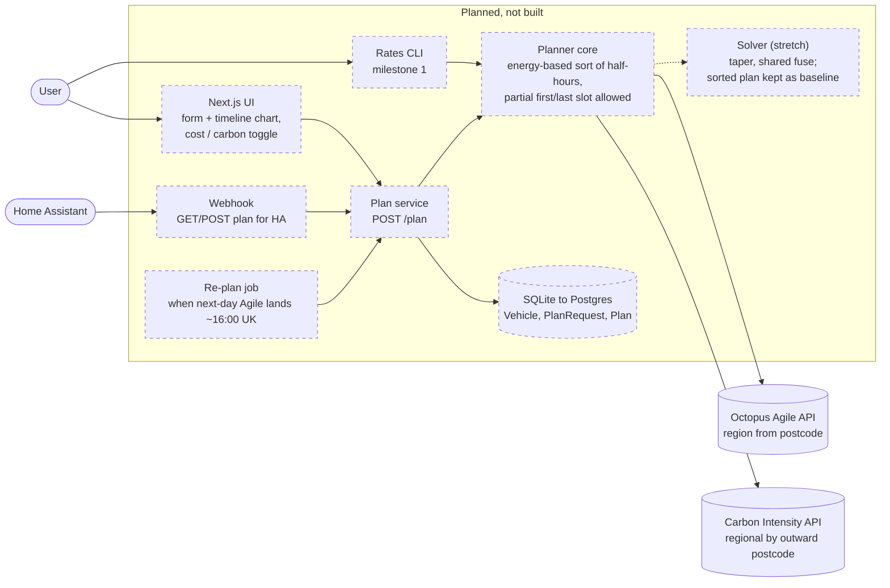

# Architecture

What exists today and what is planned. Solid boxes are built. Dashed boxes are planned from the [build plan](../smart-ev-charge-planner-build-plan.md) and do not exist yet. Update this file whenever a component, data source, entry point or data flow is added, removed or renamed.

## Today: nothing built

There is no planner code yet. A rates CLI written before the build plan was removed because it disagreed with the plan (see [decision 4](decisions/0004-remove-pre-plan-rates-cli.md)). The repo holds only the build plan, these docs, the lint scripts (also run by the `Lint` GitHub Actions workflow in `.github/workflows/lint.yml` on pushes to main and pull requests), the doc-check hook and the verification skill shell.

## Planned: milestones 1 to 5

Planned order: the rates CLI over an importable planner core (milestone 1), `POST /plan` on the same core (2), the UI (3), the Home Assistant webhook (4), and only then the solver (5).
